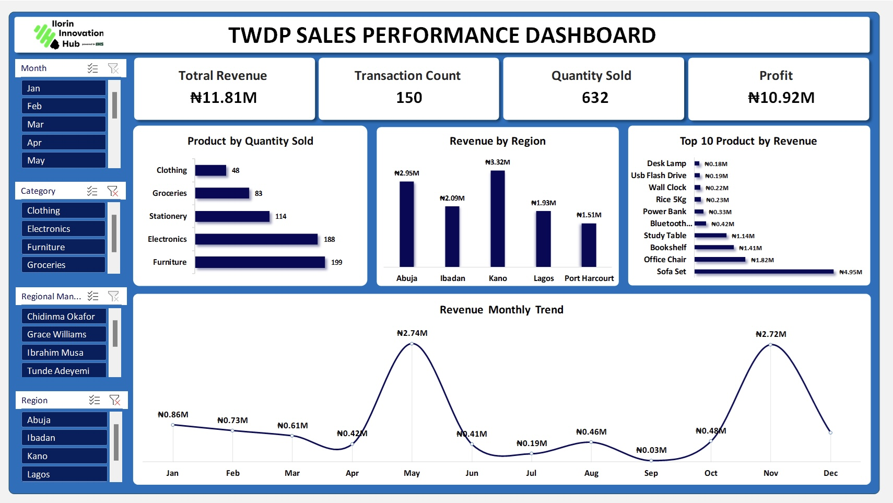

# Sales Dashboards in Excel

Two interactive sales dashboards I built in Excel as part of my training at Ilorin Innovation Hub (TWDP). Both take raw sales data and turn it into something a manager can filter and read quickly.

## Dashboard 1: TWDP Sales Performance Dashboard

Shows how sales are doing across regions, product categories and months.

**What's on it**
- Cards for total revenue, transaction count, quantity sold and profit
- Quantity sold by product category
- Revenue by region (Abuja, Ibadan, Kano, Lagos, Port Harcourt)
- Top 10 products by revenue
- Monthly revenue trend
- Slicers for month, category, regional manager and region

## Dashboard 2: Sales Performance Dashboard

A second, more detailed dashboard that also looks at who is selling and how customers pay.

**What's on it**
- Cards for total revenue, profit, units sold and orders
- Monthly revenue from January to May
- Revenue by category and by city
- Top 5 products by revenue
- Revenue by payment method (card, cash, transfer)
- Salesperson performance
- Slicers for city, salesperson, product, month, payment method and category

## How I built them

- Cleaned and organised the raw data in Excel
- Used PivotTables to summarise the numbers
- Built PivotCharts from those tables
- Connected slicers so every chart updates together
- Arranged everything on one sheet so it reads like a single report

## Things I noticed from the data

- [One thing you found, e.g. which region or product leads]
- [Another observation, e.g. a month that stood out]

## Files

- `[your first Excel file name].xlsx`: TWDP Sales Performance Dashboard
- `[your second Excel file name].xlsx`: Sales Performance Dashboard
- `IMG_3943.jpeg` and `FIRST.png`: screenshots of the dashboards

## Author

Gideon Adebayo
www.linkedin.com/in/gideon-adebayo-
